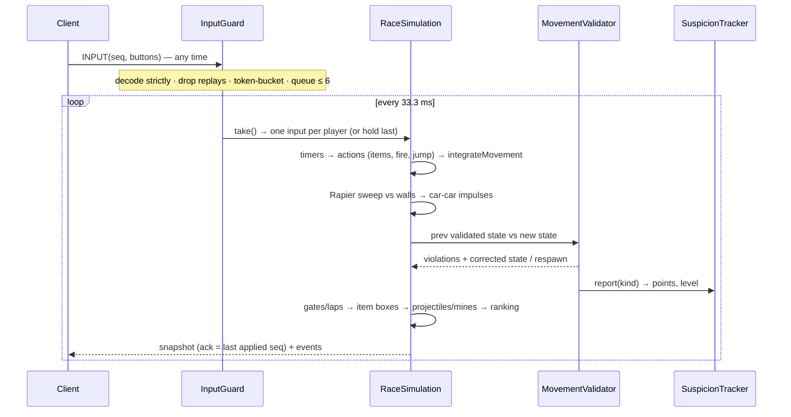

# 01 · Architecture

Garage Rumble is a browser RC combat-racing game: up to 10 cars, one track, 5 laps, roughly 5 minutes per match. Everything that decides the outcome of a match runs on the server. The browser only sends button presses.

## Components

```mermaid
flowchart LR
  subgraph Browser
    UI[UI screens + HUD<br/>apps/client/src/ui]
    R[Babylon.js renderer<br/>apps/client/src/render]
    P[Prediction + interpolation<br/>CarPredictor / SnapshotInterpolator]
    N[Connection<br/>@colyseus/sdk]
  end
  subgraph "Game server (Node, Colyseus)"
    RR[RaceRoom adapter]
    MS[MatchSession]
    SIM[RaceSimulation<br/>packages/game-core]
    AC[Anti-cheat<br/>InputGuard · MovementValidator · SuspicionTracker]
    REP[ReplayRecorder]
  end
  subgraph "API (NestJS)"
    AUTH[Auth + sessions]
    MATCH[Matches + results]
    ACS[Anti-cheat sanctions + review queue]
    SET[PrizeSettlementPort<br/>free today, escrow later]
  end
  DB[(PostgreSQL)]

  UI --> N
  N -- "INPUT 3 bytes @30 Hz" --> RR
  RR -- "SNAPSHOT ~40 B/car @30 Hz, EVENTS, RESULTS" --> N
  N --> P --> R
  RR --> MS --> SIM
  MS --> AC
  MS --> REP
  RR -- "validate session, register match, upload result + replay" --> MATCH
  UI -- "guest login, profile" --> AUTH
  AUTH --> DB
  MATCH --> DB
  MATCH --> ACS --> DB
  MATCH --> SET
```

| Unit | Path | Responsibility |
|---|---|---|
| `@rc/shared` | `packages/shared` | Config (every gameplay and anti-cheat number), the binary wire protocol, event types, zod schemas shared by the game server and the API. No dependencies on Node or the DOM. |
| `@rc/game-core` | `packages/game-core` | Deterministic simulation: track geometry, car model, Rapier walls, race and checkpoint rules, items, projectiles, anti-cheat validators, replay recorder and verifier, bots, client predictor. Runs unchanged in Node and in the browser. |
| `@rc/game-server` | `apps/game-server` | Colyseus server. `RaceRoom` handles networking and the lobby; `MatchSession` owns one match; talks to the API over `/internal`. |
| `@rc/api` | `apps/api` | NestJS + PostgreSQL: accounts, sessions, match records, results integrity, sanctions, review queue, replays, leaderboard, and the settlement port. |
| `@rc/client` | `apps/client` | Vite + TypeScript + Babylon.js. A screen stack, a HUD driven by events, prediction for the local car, interpolation for everyone else. |

The prompt suggested separate `networking` and `config` packages. They were merged into `@rc/shared`: both are small, change together, and must be identical on both sides of the wire. One package removes a class of version-skew bugs.

## The authoritative tick

The server runs `setFixedTimestep` at 30 Hz. Each tick:



Key properties:

* **One input per tick.** Sending inputs faster than the tick rate does nothing (see `test/anticheat.test.ts › speed hack by input flooding`).
* **Validation against the previous validated state.** The baseline is committed at the end of each tick. A corruption that happens between ticks is therefore still caught as a teleport.
* **Determinism.** The simulation reads no wall-clock time and draws randomness only from a seeded `Rng`. A match is a pure function of seed, config and applied inputs, and `verifyReplay` re-simulates one to prove it.

## Deployment topology (target)

```mermaid
flowchart TB
  LB[HTTPS / WSS load balancer]
  LB --> W[Static client (CDN)]
  LB --> API1[API ×N]
  LB --> GS1[Game server process ×M]
  API1 --> PG[(Postgres primary)]
  GS1 -- private network --> API1
  GS1 <-.-> REDIS[(Redis presence + driver)]
```

* Game servers are stateful (one room per match) and scale horizontally. For more than one process, Colyseus needs `RedisPresence` and `RedisDriver`; see the runbook.
* `/internal/*` API routes and `GET /metrics` on the game server must only be reachable on the private network. They are also protected by `INTERNAL_API_KEY`, which is defence in depth, not a reason to expose them.
* Measured capacity: one Node process ran 20 simultaneous 10-car matches (200 clients) at about 17% of one core. See [testing.md](../testing.md).

## Repository layout

```text
apps/
  api/            NestJS API (src/<feature>/…, migrations/, test/)
  game-server/    Colyseus server (src/rooms, src/match, scripts/loadtest.ts, test/)
  client/         Vite + Babylon.js (src/net, src/game, src/render, src/ui, src/styles)
packages/
  shared/         config, protocol, events, types + zod schemas
  game-core/      simulation, physics, anti-cheat, replay, bots, predictor (+ tests)
docs/             this documentation
.claude/skills/   project skills for AI agents working in this repo
```
