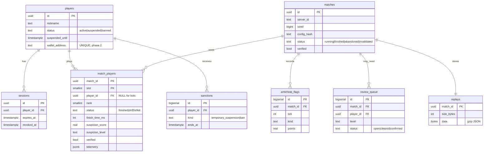

# 04 · Data model (PostgreSQL)

Migrations live in `apps/api/migrations/*.sql`. The API applies them on boot under an advisory lock, and `npm run db:migrate` applies them manually.

## Integrity rules

* `match_players (match_id, player_id)` is unique when `player_id` is set, so one account takes one seat.
* A match is **registered at countdown** (`POST /internal/matches`) with its roster, seed and config hash. A result is accepted only if it matches all of them and the match is still `running`. Retries are idempotent (`already_recorded`).
* Writing a result is a single transaction: outcome, per-player rows, flags, replay, review queue and sanctions.
* `POST /internal/servers/:id/boot` marks every `running` match of that server `abandoned` (`server_restart`).
* Stats and the leaderboard count only `matches.status = 'finished' AND verified` and `match_players.verified`.

## Indexes

`sessions(player_id)`, `matches(server_id) WHERE status='running'`, `matches(ended_at DESC)`, `match_players(player_id)`, `anticheat_flags(match_id)` and `(player_id)`, `review_queue(created_at) WHERE status='open'`.

## Retention (recommended)

Replays are the largest table (roughly 30–120 KB gzipped per match). Keep them for 30 days for casual matches and for the dispute window plus 1 year for prize matches. Move older ones to object storage.
