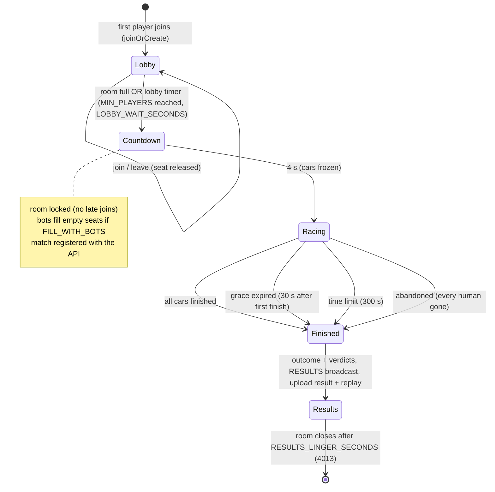

# 05 · Match lifecycle

## Player situations

| Situation | Behaviour |
|---|---|
| Disconnect during the race | Seat held for `RECONNECT_SECONDS` (20). The car gets neutral input: it coasts, stays solid and can be hit. |
| Reconnect in time | Same car; input queue reset; full state resent. |
| No reconnect | `onLeave`: forfeit, the car is removed and ranked last. |
| Leaves voluntarily | Forfeit right away. |
| AFK while connected (no input for 60 s) | Forfeit with reason `timeout`. |
| Same account in a second tab | Rejected (`4012`). |
| Late join after countdown | Room is locked; matchmaking creates or fills another room. |
| Every human leaves | Match `abandoned`, never `verified`, results stored for audit. |
| Game server crash or restart | On boot it calls the API, which marks its `running` matches `abandoned` (`server_restart`). |
| Graceful shutdown | `onDispose` aborts running matches as `abandoned` and uploads them. |
| API down at result time | Upload retried with exponential backoff (5 attempts); failures are logged. |

## Ranking

1. Finished cars by finish tick (earlier is better).
2. Unfinished cars by **confirmed progress**: gates passed × gate spacing, plus a bounded distance towards the next gate.
3. Forfeited cars last.
4. Ties broken by slot (deterministic).

Kills never rank you directly. Combat matters only because it slows rivals down: stun, knockback, and a 2 s wreck with respawn at the last checkpoint.

## Results

A player's result is `verified = false` from `restricted` (score ≥ 50) upward. A match is `invalidated` if any human reaches `match_invalidated`. Matches with bots are fine for casual play; a paid tournament must require `verified` and **no bots** (enforced by the future tournament service).
