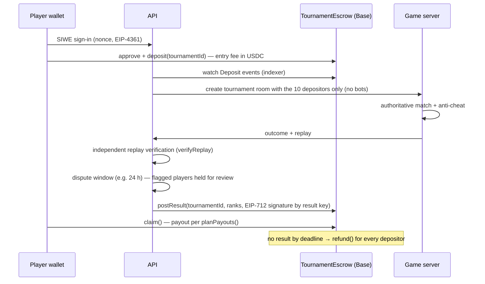

# 06 · Web3 and prize tournaments (design; phases 2–3)

> **Status:** not implemented. The MVP is free to play with no wallet. This document is the agreed plan. The code seam already exists: `PrizeSettlementPort` in `apps/api/src/tournaments/settlement.ts`.

## Rule zero

**Blockchain is never the authority for gameplay.** The game server decides results. The chain only holds entry fees in escrow and pays out what the server's verified, signed result says.

## What lives where

| On-chain (Base, USDC) | Off-chain (our servers) |
|---|---|
| Wallet sign-in (SIWE message signature) | Physics, combat, ranking, anti-cheat |
| Entry fee deposit into `TournamentEscrow` | Signing the final result (EIP-712) |
| Payout claims against the signed result | Replays, review queue, dispute handling |
| Refund if no result is posted in time | Player profiles, matchmaking |

## Flow

## Contract sketch (`TournamentEscrow`)

* `createTournament(id, entryFee, payoutBps[], rakeBps, deadline)`, owner = multisig.
* `deposit(id)`: exactly `entryFee`, one per address, closes at 10 players.
* `postResult(id, winners[], amounts[], sig)`: verifies the EIP-712 signature from `resultSigner`; the amounts must sum to ≤ pool − rake.
* `claim(id)`: pull payment (no push loops); a second claim reverts.
* `refund(id)` after `deadline` with no result.
* `setResultSigner` behind a **timelock**, a key rotation path. The signer key lives in a KMS/HSM and never on the game server.
* Foundry tests: wrong fee, double deposit, forged signature, replayed signature on another tournament (chain id + contract + tournament id in the domain), double claim, refund after deadline, rake bound, re-entrancy.

## Payout plan

`planPayouts()` (already implemented and tested) works in integer minor units. It pays only `verified` ranks. A disqualified rank's share is **withheld for review**, never redistributed automatically, so a late disqualification cannot be gamed. Rounding dust stays with the house.

## Why Base + USDC

Base fees are fractions of a cent, USDC is native, and EVM tooling (Foundry, viem, wagmi) is mature. A stablecoin keeps prizes clear of speculation. There is **no project token**. TON plus a Telegram Mini App is the alternative if distribution through Telegram matters more.

## Legal and compliance (must be resolved before mainnet)

* **Entry fee + prize pool is treated as gambling in many jurisdictions**, even for skill games. It needs legal review per market, geo-blocking, age checks and probably KYC.
* **Sanctions:** USDC (Circle) and exchanges block addresses tied to sanctioned countries. Operating from or serving those regions risks frozen funds and legal exposure for the operator.
* Lower-risk first step: **free entry with a sponsor-funded prize pool** (no stake from players).
* Keep everything on **testnet (Base Sepolia)** until counsel signs off.

## Phases

1. ✅ MVP gameplay, authoritative server, anti-cheat, results, replays (this repo).
2. SIWE sign-in: `players.wallet_address` (column already present), nonce endpoint, `siwe` verification in `AuthService`.
3. Escrow on Base Sepolia: contract plus Foundry tests, result signer, indexer, an `EscrowSettlement` adapter implementing `PrizeSettlementPort`.
4. Independent verifier service and dispute window.
5. Mainnet, only after legal review.
